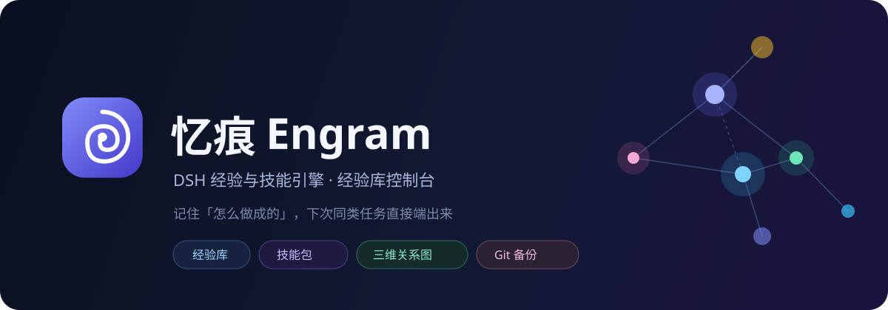
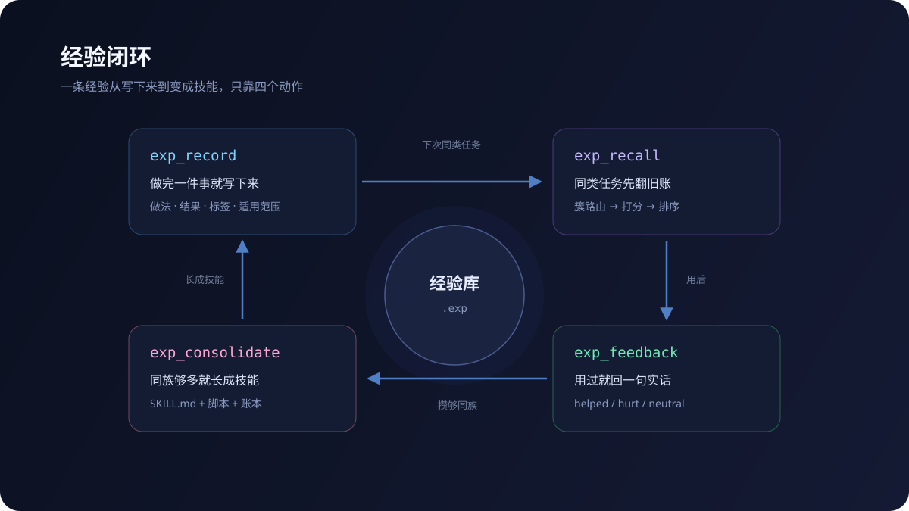
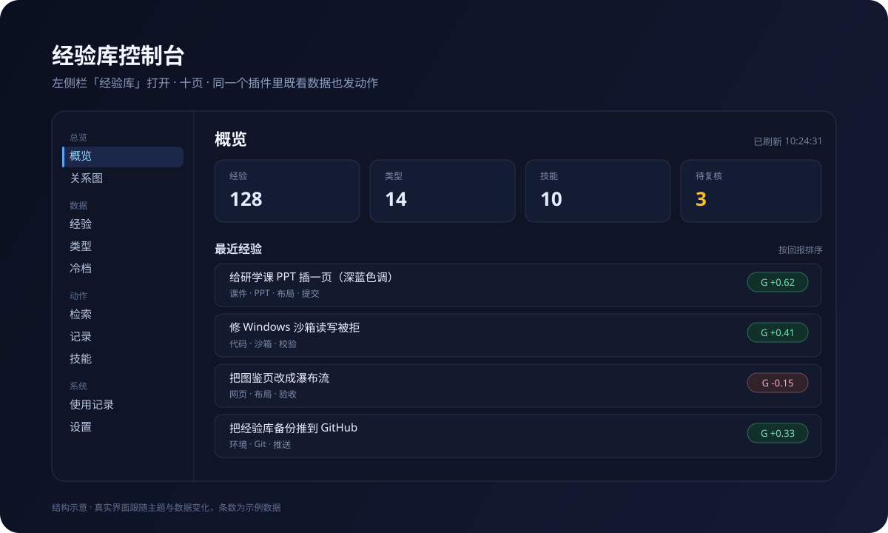
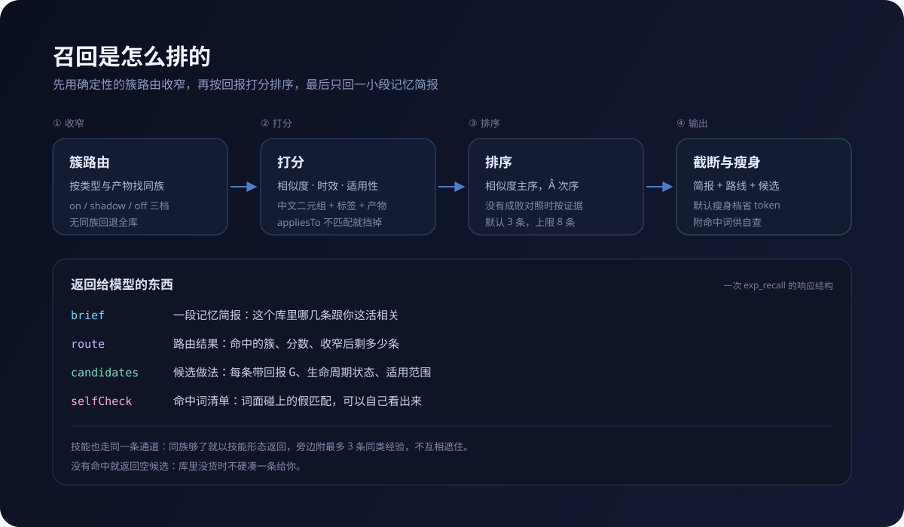
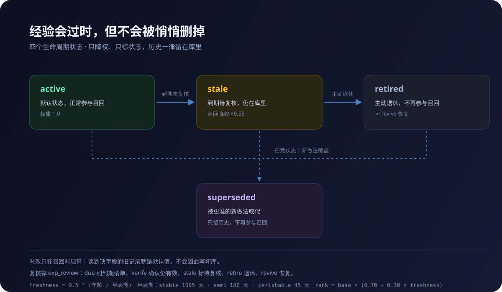
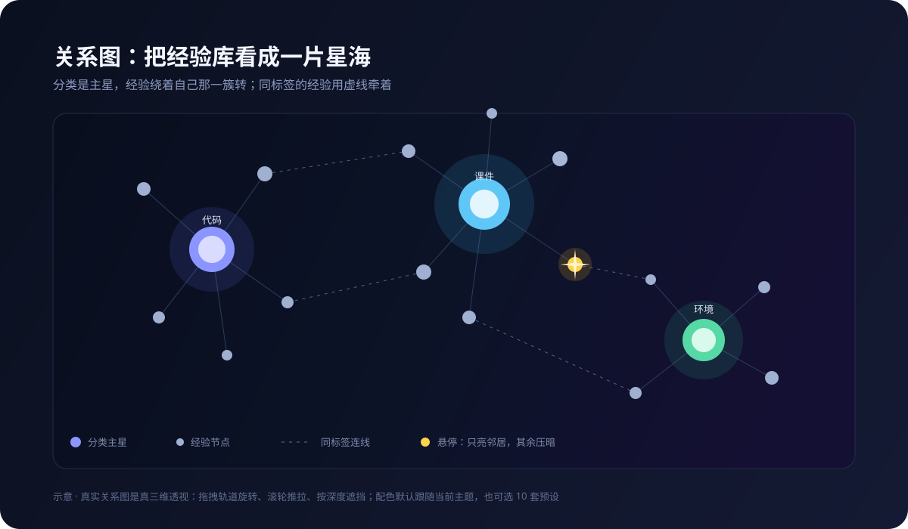

<div align="center">
  
</div>

<h3 align="center">Engram（记忆痕迹）· 经验与技能引擎 + 经验库控制台，一个标准 DSH 插件</h3>

<p align="center">
  
  
  
  
</p>

> 让 agent 记住「这件事上次是怎么做成的」，下次遇到同类任务直接端出来 —— 而不是每轮从零开始。

一条经验 = **做法 + 结果 + 适用范围 + 标签**。它不像聊天记录那样随会话消失，也不是把文档堆进一个文件夹：写进库里之后，它会被检索、被打分、被复核，攒够了还会长成技能。

| 常见做法 | 忆痕的做法 |
|---|---|
| 记忆存在上下文里，换个会话说没就没 | 落盘成经验库，跨会话、跨项目都还在 |
| 关键词命中就算相关 | 簇路由先收窄，再按相似度 + 回报 + 时效打分 |
| 记完就烂在库里 | 半衰期降权、到期复核、退休或标记被取代 |
| 知识只是一段文字 | 同族经验沉淀成带脚本的技能包 |
| 只有模型自己知道 | 控制台里人能看、能筛、能审、能改 |

---

## 一条闭环

<div align="center">
  
</div>

四个动作驱动整条闭环，配套七个内核工具，都挂在同一个插件的工具面上：

| 工具 | 干什么 | 关键点 |
|---|---|---|
| `exp_record` | 把一次做法写成经验 | 同一做法就地更新，近似的新做法会把旧条标成「被取代」；标签凑「对象 + 动作」 |
| `exp_recall` | 按任务意图召回旧经验 | 簇路由 → 打分 → 排序，只回一小段简报，默认 3 条 |
| `exp_feedback` | 回报用后结果 | `helped / hurt / neutral` 按 EMA 修正回报 G，下次排序就按新 G |
| `exp_consolidate` | 同族经验沉淀成技能 | 同族 ≥3 条且正负都有才允许，生成 `SKILL.md` + `skill.json` 账本 |
| `exp_skill_attach` | 给已有技能补正文 / 挂脚本 | 脚本进 `scripts/`，并在 `SKILL.md` 维护「## 脚本」清单 |
| `exp_type` | 管理主分类与标签词表 | list / create / rename / merge / delete / assign / labels |
| `exp_review` | 复核经验时效 | due 到期清单、verify、stale、retire、revive |

---

## 控制台：十页

<div align="center">
  
</div>

左侧栏多出「经验库」入口，打开就是一个独立控制台 —— 既看数据，也发动作，不用回聊天窗口敲命令。

| 页 | 看什么 / 做什么 |
|---|---|
| **概览** | 条数、类型、技能、待复核数量，存储与备份状态 |
| **关系图** | 三维星海视图：分类主星、经验节点、同标签连线 |
| **经验** | 全量经验列表，筛选、排序、单条详情与反馈历史 |
| **类型** | 主分类与次级标签的词表维护（改名、合并、删除） |
| **冷档** | 超出容量被下沉的老经验，只读 |
| **检索** | 手填一句意图跑一次召回，对照结果长什么样 |
| **记录** | 手工写一条经验，等价于 `exp_record` |
| **技能** | 技能包列表、正文与脚本、导入、注册到全局、遗忘 |
| **使用记录** | `exp_*` 调用流水（`usage.jsonl`） |
| **设置** | 存储位置 / 备份与账号 / 内核参数 / 界面与关系图 / 维护 |

> 关系图之外的页面都做了「填满高度 + 内部滚动」，窗口窄到 1180px 以下会自动回落整页滚动；表格表头在滚动时吸顶。

---

## 召回：不靠关键词，也不靠热度

<div align="center">
  
</div>

一次 `exp_recall` 走四步，全程确定性计算，不额外调模型：

1. **簇路由**：先按素材类型和产物找「同族」。`routing` 可设 `on / shadow / off` —— `shadow` 只记录路由结果、不实际收窄，用来对比效果；没有同族就老老实实回退全库。手动 `exp_record` **不自动归族**（主分类由模型自己判断，没给就落「未分类」并在回执里提示补）；只有回合收尾的自动记录才走更松的门槛（`autoRouteMinScore`，默认 0.08）归族。
2. **打分**：相似度由四个因子组成，覆盖率占大头，保证短意图也召得回：

   | 因子 | 权重 | 说明 |
   |---|---|---|
   | coverage | 0.40 | 意图里的词被候选覆盖多少 |
   | jaccard | 0.25 | 两边词集的交并比 |
   | artifact | 0.20 | 产物语义组命中（PPT / 文档 / 表格 / 代码 / 网页 / 机器人 / Git …） |
   | bigram | 0.15 | 中文二元组重合 |

   相似度低于 `0.12` 的直接不参与估计。

3. **排序**：按回报 G（JitRL 的 Â 优势）排，不按「谁用得多」。某条没有成败对照时 Â 区分不出好坏，就退回按相似度 × 证据强度排。时效也进排序：`rank = base × (0.70 + 0.30 × freshness)`。
4. **输出**：返回 `brief`（简报）+ `route`（路由结果）+ `candidates`（候选做法）。默认瘦身档，`detail: true` 才给全字段。

还有两条防踩坑的设计：

- **适用范围门控**：经验声明了 `appliesTo`（模型 / 工具版本 / 环境）时，当前环境不匹配就默认不召回；要看得传 `includeMismatched: true`，命中会标 `applicability=mismatch`。
- **命中词自查**：返回里带 `matchedTerms`，词面碰巧重合的假匹配（比如「页面动画」撞上「PPT 页面」）模型自己就能看出来，换个更具体的意图重试。

---

## 经验会过时，但不会被悄悄删掉

<div align="center">
  
</div>

| 状态 | 含义 | 对召回的影响 |
|---|---|---|
| `active` | 默认状态 | 正常参与，权重 1.0 |
| `stale` | 到期未复核（半衰期到了） | 仍在库里，排序降权 ×0.55 |
| `retired` | 主动退休 | 不参与召回，可 `revive` 恢复 |
| `superseded` | 被更准的新做法取代 | 只留历史，不参与召回 |

时效是**读的时候现算**的，不写回库：读到缺字段的旧记录就当默认值，所以升级插件不会把老库改坏。

| 易腐层 | 半衰期 |
|---|---|
| `stable`（偏好、硬约束） | 1095 天 |
| `semi`（判断原则，默认） | 180 天 |
| `perishable`（具体步骤、命令、API） | 45 天 |

`freshness = 0.5 ^ (年龄 / 半衰期)`。到期了不是删掉，而是进 `exp_review` 的 `due` 清单，由人或模型决定 `verify`（仍然有效）还是 `retire`（退休）—— 历史一律保留。

---

## 关系图：把库看成一片星海

<div align="center">
  
</div>

真三维透视：拖拽轨道旋转、滚轮推拉、按深度排序遮挡。分类是主星，经验绕着各自的簇转；同标签的经验之间用虚线牵着，可以一键隐藏。

- **配色**：默认直接读当前 DSH 主题的渐变 token（跟随主题），也可以自选 10 套预设 —— 蓝紫星辰（默认）/ 超能量体 / 宇宙 / 赛博朋克 / 极光空灵 / 黑金科幻 / 蒸汽复古 / 青墨国风 / 极简冷科技 / 熔岩炽热。
- **背景**：跟随主题 / 浅色 / 深色三档，画布左下角有胶囊可以直接切（切背景时会同步改节点明暗补偿，不然颜色会算错）。
- **交互**：悬停只亮邻居、其余压暗；越新的经验越亮；拖拽有惯性，空转时有呼吸感，分类主星有差速漂移与深度视差。
- **性能开关**：自动旋转速度、泛光 bloom、色散毛刺、浮尘数量都能单独关，机器吃力就调低。

---

## 技能：沉淀出来的是完整技能包

同族经验攒够（≥3 条，且正负结果都有），`exp_consolidate` 会给出一个技能 —— 不是一篇散文，是能直接用的包：

```
<dataDir>/skills/<slug>/
├── SKILL.md          # frontmatter + 正文（步骤、常见例外、已内化）
├── skill.json        # 账本：分类、便签、置信度、障碍计数、脚本清单
└── scripts/          # 脚本附件，登记在 skill.json 的 files
```

- 沉淀时可带 `body`（手写正文）和 `files`（脚本路径）；已有技能用 `exp_skill_attach` 补料。
- 召回时**技能与经验并列返回**：技能给正文，旁边最多附 3 条同类经验做参照，不会互相遮住。
- 技能**不会**偷偷写进 `$DSH_HOME/skills/`。要它变成 DSH 全局技能，得在控制台技能详情里手动点「注册技能到全局」（junction 到 DSH skills，建不了链接才复制）；注册后经验库不再排序它，按钮变「取消注册」。
- 「忘记技能」是两步确认删目录，注册中的会先取消注册。

---

## 技能命中：首给全文，再命中给短回执，压缩后重取

技能正文不再「每次命中都按原价重发」。同一次会话里命中同一个技能，回执分三态：

| 情形 | 回执 | 体量 |
|---|---|---|
| **首给**：本会话没给过，或正文改过（`bodyHash` 变了） | 全文 + `runtime` + `matchedTerms` | 4–7k token |
| **复用**：给过、且那条结果还在可见上下文里 | ≤400 字短回执：`reused` 元信息 + 3 条正文二级标题锚点 + 重取入口 | 几百字 |
| **重给**：给过、但正文已被压缩遮掉 | 全文 + 「上文版本可能已被压缩，以此为准」 | 4–7k token |

- **正文不复原，只重取**：复用回执里写着 3 条锚点（正文里的二级标题原文）。拿锚点对不上当前任务、或者需要具体步骤和脚本时，调 `exp_recall({ skill: '<slug>', load: true })` 现读文件重取正文 —— 拿到的永远是当前这一版，不是压缩前的旧版。
- **会话技能目录**：本会话命中过的技能会发一条清单（条目名带 `engram:` 前缀，只有名字 + 截断描述，不含正文和路径）。清单被压缩遮掉时，下一步自动补发一份替换版并声明旧清单作废，模型照清单里的名字重新 `exp_recall` 即可，不用凭印象硬做。
- **两个开关**：设置 → 内核参数里有「会话技能目录」（`skillCatalog`）和「复用短回执」（`reuseReceipt`），默认都开。关掉「会话技能目录」就完全退回旧行为（每次命中都给全文、不发清单也不补发）；排障时可关掉「复用短回执」强制每次看全文。目录条数上限（`catalogMaxSkills`，默认 5）与描述截断长度（`catalogDescriptionChars`，默认 300）只在 `~/.dsh/engram/settings.json` 里改，不在设置页。
- **在哪里看**：控制台「使用记录」页的「命中」列直接显示首给 / 复用 / 重给，KPI 有「复用命中 / 重给全文」两格，展开某一行还能看到对应的 `skill` 与 `bodyHash`（正文版本）。

---

## 存储、备份与设置

- **数据目录**：`manifest.json` + `buckets/` 分片存储（老库 `exp-lib.json` 直接兼容）。超出容量上限的老经验下沉到「冷档」，是安全阀，不是删除。
- **Git 备份**：库本身就是一个普通 git 仓库（`<dataDir>/.git`），控制台「设置 → 备份与账号」里填远端即可 init / 提交推送 / 拉取。
  - 推送策略三档：**检测到远端有新提交时问我**（默认）/ 直接本地覆盖云端（覆盖前先把旧远端 HEAD 存进 `refs/engram/overwritten/*`）/ 只允许快进。
  - GitHub 用**设备码登录**，不用手贴 PAT：浏览器打开验证页、输入一次性代码，token 自动存进本机设置，然后「加载我的仓库」点选即可。机器有 TLS 拦截代理时会自动导出系统根证书重试。
  - 可以设自动备份间隔（最小 15 分钟，没有改动就跳过）。
- **设置**：写在 `~/.dsh/engram/settings.json`，控制台分五组 —— 存储位置 / 备份与账号 / 内核参数 / 界面与关系图 / 维护。
- **提示段**：每轮系统提示里会多一段「【经验库】」说明。默认瘦身档约 120 字符（怎么用 + 条数 + 前几个技能），可以关掉，也可以换成完整档（列全部类型与技能，约 1300 字符）。
- **会话里随手存**：助手消息下方的「存经验」按钮，直接从会话记录里挑内容写成经验，不用手工复制。

---

## 安装

```bash
npm pack
dsh plugin --profile <profile> add ./dsh-engram-0.23.0.tgz
```

重启 DSH 后只会出现**一个**插件行「dsh-engram」：左侧栏多出「经验库」，工具面 `exp_*` 与控制台 API `/exp-ui/api` 同包同入口。

要求 Node ≥ 22、DSH 客户端模块可用；`@deepseek-ai/dsh-client-ui-primitives`、`@deepseek-ai/dsh-tools` 都是可选 peer，拿不到会退化成自绘图标。

## 快速上手

```text
① 做完一件事，记下来
   exp_record(intent="给研学课 PPT 插一页", action="用 16:9 母版重排 + 统一字号",
              outcome="accepted", labels=["课件","PPT","布局"])

② 下次同类任务，先翻旧账
   exp_recall(intent="给课件 PPT 加一页过渡页（深蓝色调）")

③ 用过之后回一句实话
   exp_feedback(id="<候选 id>", result="helped")
```

跑几轮之后去控制台「关系图」看，经验会自己聚到分类主星周围；同族攒够了，`exp_consolidate` 就会提示可以沉淀成技能。

**快捷键**：`Ctrl/Cmd+K` 命令面板 · `?` 快捷键表 · `g` + `o/e/r/n/s/t/u/,` 跳页 · `Shift+R` 刷新 · `j/k` 列表上下移动。

---

## 目录结构

| 路径 | 作用 |
|---|---|
| `plugin.js` | 唯一入口：内核工具面 + 控制台 API |
| `cordis.patch.yml` | 只插一条 `engram` 行（裸包名） |
| `kernel/` | 引擎：存储分片、检索、簇路由、沉淀、反馈、技能、时效、Git 同步 |
| `ui/shell.js` | 控制台 API 外壳 |
| `ui/live.js` / `ui/mock.js` | 数据源：真实库 / 内置示例数据（mock 只用于看界面） |
| `client.js` | 控制台界面（DSH 模块加载器 bundle） |
| `docs/images/` | README 配图（SVG） |
| `tools/migrate-tags-v2.mjs` | 标签迁移脚本，默认 dry-run，`--apply` 前整包备份 |

## 最近几个版本

- **0.23.0** 主分类回到模型负责：`exp_record` 的 `typeName` 改成「先自己判断，实在分不出来才留空」，没给就落「未分类」并在回执里提示补；手动记录不再自动归族，引擎簇路由只服务自动记录并单独用 `autoRouteMinScore`（默认 0.08）；未分类不再静默；提示段加一句引导；`exp_recall` 的 usage 行新增 `shadow`（两套 top5 落盘，供后续切换判据）
- **0.22.0** 控制台 P2：经验页与技能页新增「到期复核」清单（勾选批量「确认仍有效 / 标待复核」）；概览在关闭自动记录时给出提示；设置页新增「技能正文模式」（全文 / 裁剪）；补齐 0.20.2–0.21.0 的接口文档
- **0.21.2** UI 对齐后端：经验详情显示来源 / 产物 / 会话 / 分步回报，待判定可批量回填；检索页显示标签影子、生命周期与适用性提示、技能命中自查；技能详情显示运行时路径与命令、正文 hash、固化进度；详情里的分类与标签移到标题下方
- **0.21.0** 单会话技能目录 V2：技能命中首给全文、同一会话再命中改给 ≤400 字复用短回执（带 3 条二级标题锚点，对不上就 `exp_recall({skill, load:true})` 重取）；正文变了或被压缩遮蔽自动重给全文；每个会话发一条技能目录，目录条目被压缩遮蔽后整份补发；控制台使用记录页能看到「首给 / 复用 / 重给」
- **0.20.9** 自动记录钩子（设置里可关，默认开）、`stepRewards` 限幅与拒绝、技能召回即用（命中给全文 + `runtime` 绝对路径与可执行命令）
- **0.20.8** 关系图：技能四面体缩小时保留形状，不再退回菱形
- **0.20.7** 黑盒迭代修复：错误码、标签归一、坏库检测
- **0.20.6** 关系图可隐藏同标签经验连线
- **0.20.5** 关系图差速旋转 + 深度视差
- **0.20.0 ~ 0.20.4** 经验时效治理与标签分类、`appliesTo` 运行环境门控、关系图运动
- 完整发布记录见 [RELEASES.md](RELEASES.md)

---

## 借鉴与致谢

这个插件是长期迭代出来的，不少设计来自公开项目与 DSH 生态。写清楚借了什么，免得以后当成原创；完整清单（含论文与方法来源）在 [THIRD-PARTY-NOTICES.md](THIRD-PARTY-NOTICES.md)。

| 来源 | 借了什么 | 体现在哪 |
|---|---|---|
| [asdfd3/3d-memory-sea](https://github.com/asdfd3/3d-memory-sea) | 星海式关系图：球面簇布局、真三维透视投影、轨道旋转 / 滚轮推拉、按深度遮挡、流光与景深 | 控制台「关系图」页（0.9.0 起） |
| [Yuuyuko-uu/dsh-xingxi](https://github.com/Yuuyuko-uu/dsh-xingxi) | 悬停只亮邻居其余压暗、越新越亮的新近度表达、镜头自动适配 | 关系图交互（0.10.0 起） |
| [DeepSeek Harness](https://github.com/deepseek-ai) | 插件双半结构、`dsh.client` bundle 约定、`sidebar.panellist` 只返回图标本体的契约 | `plugin.js` / `client.js` 的整体形态 |
| [omdsh-dev/dsh-mnemon](https://github.com/omdsh-dev/dsh-mnemon) | 本插件早期是它的记忆空间 Provider；分类型、按簇召回、经验与技能分层都从这套思路长出来 | kernel 的类型 / 簇 / 技能模型（0.11.0 起解耦，不再依赖） |
| [libiwolve/dsh-experience-library](https://github.com/libiwolve/dsh-experience-library) 等 | 「程序性经验」与「陈述性记忆」分层的定位、按证据分级打分、检索到 ≠ 注入的裁决立场 | kernel 的经验模型与反馈口径（详见第三方声明） |
| JitRL：Just-in-Time Reinforcement Learning | `kernel.js` 的数学映射：状态抽象、折扣回报、非参数 critic、Â = Q̂ − V̂ | `exp_recall` 的排序依据 |
| 前身 `dsh-exp-lib-provider`（同作者） | `exp-lib.json` 存储格式、反馈学习率、退休 / 取代语义 | `kernel/store.js` 兼容路径，源码用 `@legacy-provider` 标注 |

关系图的**配色不借任何预设主题**：默认直接读 DSH 运行时的主题 token，跟随当前主题变化；预设配色只在手动选择时接管。

### 历史沿革

1. `dsh-exp-lib-provider`：作为 dsh-mnemon 的记忆空间 Provider，只提供数据面。
2. `dsh-engram` 0.1–0.10：独立成「引擎」+「控制台外壳」两个插件。
3. `dsh-engram` 0.11 起：合并为**一个插件**（工具面 + 控制台同包同入口），与记忆插件彻底解耦。

## 许可

MIT，第三方声明见 [THIRD-PARTY-NOTICES.md](THIRD-PARTY-NOTICES.md)。
